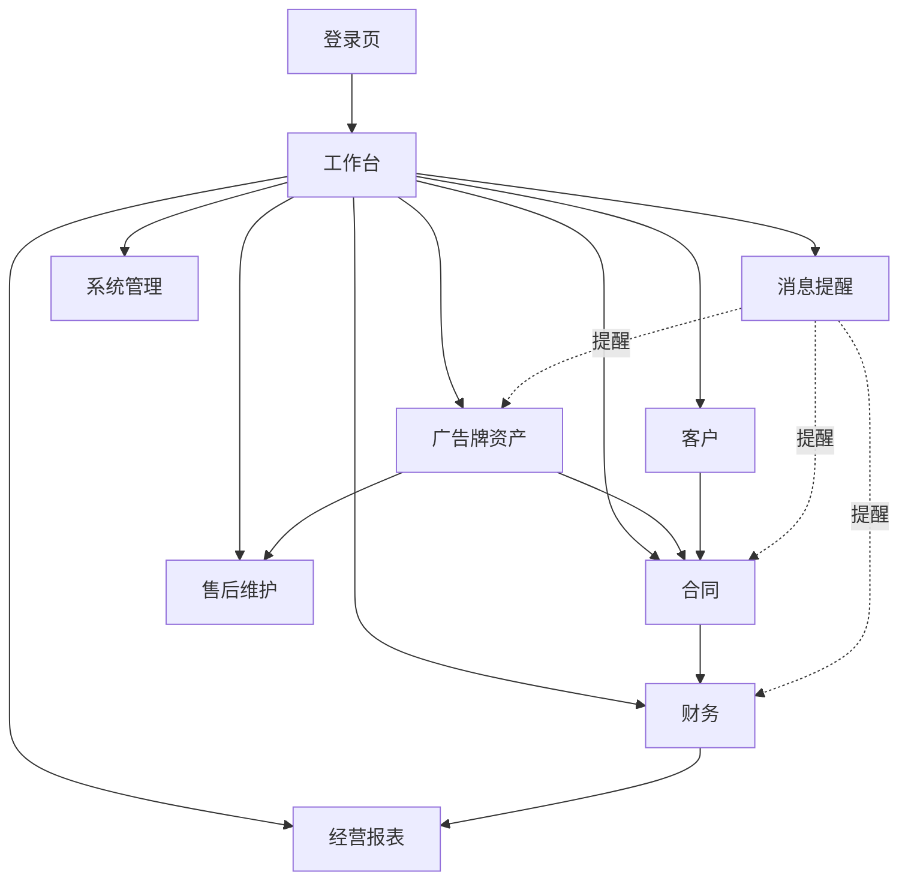

# 01 信息架构（Information Architecture）

| 项 | 内容 |
|---|---|
| 阶段 | S1 / Phase 1 |
| 依据 | 需求基线 V1.0、TAPD 9 大类（含 P0 全局与工作台）、甲方 PDF |
| 原则 | 角色驱动、对齐 8 大类、渐进披露、页面可追溯 TAPD |

## 一、全局框架

- 桌面 Web SaaS，三段式：**左侧导航（可收起）+ 顶栏（面包屑/搜索/待办/用户菜单）+ 主内容区**。
- 主内容区固定节奏：页面标题与主操作 → 统计摘要（如有）→ 筛选条件 → 列表/表单/详情 → 分页或批量操作。
- 登录页、锁屏为独立全屏页，不在框架内。

## 二、导航树（一级 / 二级）

```
工作台（P0-01 经营工作台，登录后默认首页：待办、核心指标、风险、广告牌状态分布）
广告牌资产
 ├─ 路段/地区/运营单位
 ├─ 广告牌列表
 ├─ 广告牌档案（基本信息 · 三个桩号 · 证件 · 照片）
 └─ 广告牌变动（新建/拆除/移位）
客户
 ├─ 客户列表
 ├─ 客户档案（资料 · 开票信息 · 余额欠款 · 合作记录）
 └─ 黑名单
合同
 ├─ 合同列表
 ├─ 新建/编辑合同（选客户 · 选多牌 · 年度租金 · 租期查重）
 └─ 合同详情（状态 · 续签/变更/解除 · 附件）
财务
 ├─ 应收账单
 ├─ 收款登记与流水
 ├─ 核销处理（部分/多账单/挂账）
 ├─ 支出与应付
 └─ 发票登记
经营报表
 ├─ 广告牌数量 · 合同执行 · 收款情况
 ├─ 应收欠款 · 经营收益
 └─ 导出 Excel / PDF
消息提醒
 └─ 提醒中心（合同到期 · 欠费 · 证件到期 · 付款到期）
售后维护
 ├─ 售后问题列表
 ├─ 登记售后问题
 └─ 问题处理与维修记录
系统管理
 ├─ 岗位与权限
 ├─ 数据字典
 └─ 操作日志
```

> 说明：P0-01 经营工作台为登录后默认首页，聚合各模块待办与指标，不引入新业务；P1-01 登录为独立页；P1-03"不同岗位看到内容不同"是权限生效结果，体现在各角色菜单矩阵，不单列菜单。审批待办、AI 助手按确认结论列后续，不在本期导航。

## 三、角色 × 菜单可见性矩阵

| 菜单 | 运营档案员 | 合同管理员 | 财务管理员 | 售后维护 | 部门领导 | 系统管理员 |
|---|---|---|---|---|---|---|
| 工作台 | ✅ | ✅ | ✅ | ✅ | ✅(只读) | ✅ |
| 广告牌资产 | ✅ | 查看 | — | — | 只读 | — |
| 客户 | — | ✅ | 查看 | — | 只读 | — |
| 合同 | — | ✅ | 查看 | — | 只读 | — |
| 财务 | — | 查看 | ✅ | — | 只读 | — |
| 经营报表 | — | — | — | — | ✅ | — |
| 消息提醒 | ✅(证件) | ✅(合同) | ✅(欠费/付款) | ✅ | 只读 | — |
| 售后维护 | — | — | 查看(费用) | ✅ | 只读 | — |
| 系统管理 | — | — | — | — | — | ✅ |

遵守 ADR-0005：系统管理员不自动获得业务数据查看权。

## 四、结构关系图


