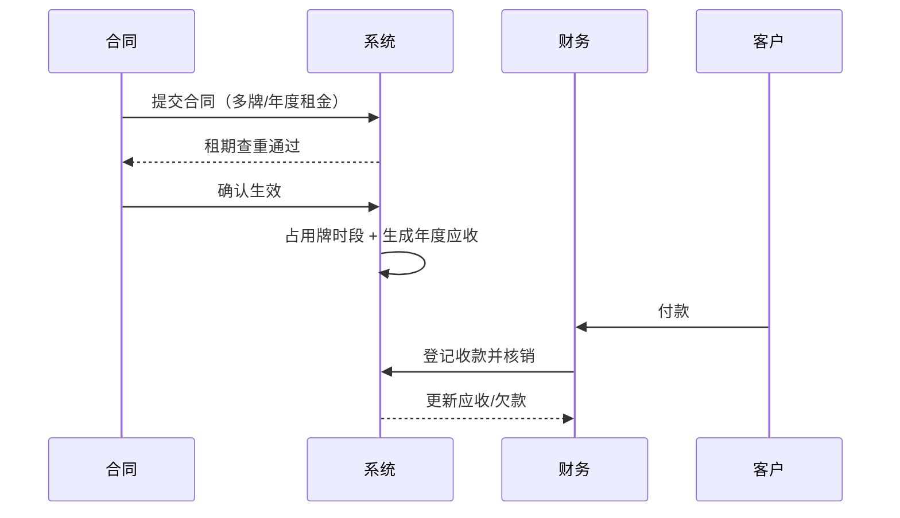

# 02 用户流程（User Flows）

| 阶段 | S1 / Phase 1 |
|---|---|
| 依据 | 需求基线 V1.0、甲方 PDF 业务闭环 |
| 说明 | 含跨角色泳道；★ 为甲方验收主闭环 |

## 一、端到端主闭环 ★

## 二、分流程说明

### F1 登录与会话（所有角色）
输入账号密码 → 校验 → 成功进工作台；错误提示；连续 5 次失败锁定（时长待甲方确认）；未登录访问跳登录；超时/退出销毁会话。

### F2 广告牌建档（运营档案员）
维护路段/地区/运营单位 → 新建广告牌（基本信息）→ 分别记三个桩号 → 登记路政/保险/年审证件有效期 → 上传现场照片；公路用地无路政许可给风险提示。

### F3 客户登记（合同/财务）
登记客户基本信息 → 维护开票信息（可多抬头、设默认）→ 查看余额欠款；违约客户加入黑名单（填原因）。

### F4 签约（合同管理员）
选客户（黑名单拦截）→ 录入租期、自动生成合同号 → 关联多块广告牌并设各自租期 → 按牌按年设租金与付款截止日 → 租期查重（重叠拦截）→ 提交确认 → 生效、占用牌时段、自动生成年度应收。
> 制单人不能自行确认生效（需确认环节）。

### F5 收款与核销（财务）
登记收款（客户/日期/金额/类型/凭证）→
- 部分缴款：分次核销、自动算剩余欠款；
- 合并付款：一笔钱拆分抵多张账单；
- 用途不明：先挂客户账，确认后再分配；
核销后同步更新应收与欠款。

### F6 支出与发票（财务）
登记应付（路政/保险/维护）与付款流水 → 登记发票（关联客户/合同/收款，发票号唯一）。

### F7 报表与导出（部门领导，只读）
选维度/期间 → 查看数量/合同执行/收款/欠款/收益报表 → 导出 Excel 或 PDF；数字与业务数据实时一致。

### F8 提醒（系统触发 → 对应角色）
合同到期 → 合同管理员；欠费/付款到期 → 财务；证件到期 → 运营档案员；提醒可标记已处理。

### F9 售后闭环（售后维护）
登记问题（选牌/类型/描述/紧急度/照片）→ 分派维修（处理中）→ 记录处理进度 → 完工填维修结果/费用/配件/照片 → 关闭；维修费用联动生成应付；超时自动预警。

## 三、跨角色泳道（签约→收款）

